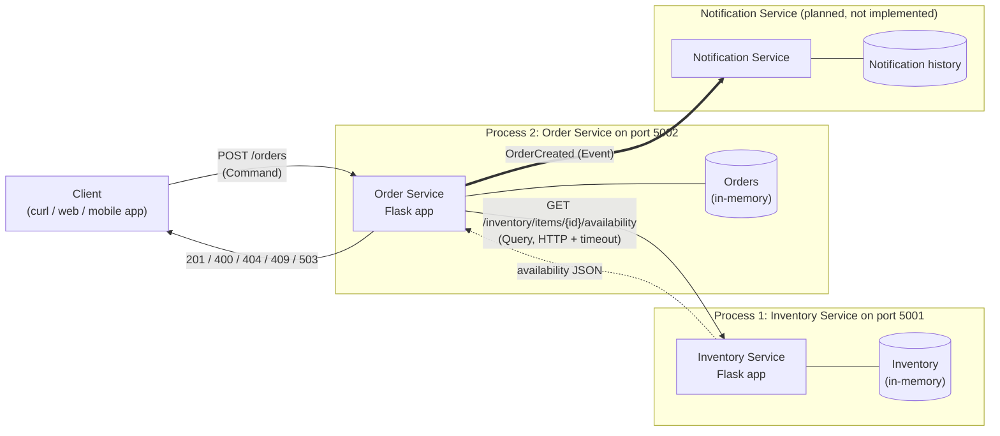

# Distributed Online Store: Order and Inventory Services

## Abstract

This project is a small online-store backend split into independent services. The **Order Service** accepts order requests and, before creating an order, asks the **Inventory Service** over HTTP/REST whether the requested item and quantity are available. Each service runs as its own Python process on its own port and owns its own data. A third component, the **Notification Service**, is part of the architecture only: the Order Service records (logs) an `OrderCreated` event as a placeholder for future broker-based publishing, which a Notification Service could then consume.

The project demonstrates these distributed-systems concepts:

- service boundaries and data ownership
- synchronous request/response communication between processes
- commands, queries, and events
- fault isolation: the Order Service survives an Inventory Service outage, returns HTTP 503, and recovers on its own once inventory comes back

## Business Value

In a real online store, orders, inventory, and notifications change for different reasons and at different rates:

- **Orders** are tied to checkout and customer history. They need to be reliable and auditable.
- **Inventory** is tied to warehouses and suppliers. It is read very heavily (every product page and every checkout) and may be fed by external systems.
- **Notifications** (email, SMS, push) depend on third-party providers that are slow or sometimes unavailable.

Keeping these as separate services means a team can change how stock is tracked without touching checkout code, scale inventory reads during a sale without scaling everything else, and stop a slow email provider from blocking customers who are placing orders. A failure in one area is contained and reported clearly (for example, "inventory unavailable, please retry") instead of taking down the whole store.

## Architecture Diagram



Each box with a "Process" label is a separate operating-system process that is started and stopped on its own. The services do not share memory or a database. They communicate only through HTTP. The thick arrow to the Notification Service is the planned asynchronous event path. Right now the Order Service only logs the event (`EVENT OrderCreated ...`).

## Component Responsibilities

| Component | Responsibility |
|---|---|
| **Client** | Sends order requests (`POST /orders`) to the Order Service and handles its responses, including retrying after a `503`. The client talks only to the Order Service. It never needs to know that an Inventory Service exists. |
| **Order Service** | Validates order input, asks the Inventory Service whether stock is available, creates and stores orders, returns meaningful HTTP status codes, and records (logs) an `OrderCreated` event as a placeholder for future broker-based publishing. It handles Inventory Service failures (connection errors and timeouts) without crashing. |
| **Inventory Service** | Tracks how many units of each item are in stock and answers availability queries. It is the only source of truth for stock levels. |
| **Notification Service** | *(Architectural component, not implemented.)* Would subscribe to `OrderCreated` events and notify the customer, for example by sending a confirmation email. Because it reacts to an event instead of being called directly, a notification failure would never block or roll back an order. |

## Data Ownership

| Service | Owns |
|---|---|
| **Order Service** | Order IDs, the item ID and quantity of each order, order status, and order timestamps (`created_at`) |
| **Inventory Service** | Item quantities and availability |
| **Notification Service** | Notification delivery state and notification history (once implemented) |

**No service directly modifies another service's data.** The Order Service never reads or writes the `INVENTORY` dictionary. It can only *ask* the Inventory Service through its public API. In the same way, the Inventory Service knows nothing about orders.

## Service Boundaries

The services are split along business capabilities: *taking orders*, *knowing what is in stock*, and *telling customers what happened*. Each service owns only the data for its own capability and exposes that data only through an API:

- The **Order Service** may create and read orders. To learn about stock, it must call the Inventory Service.
- The **Inventory Service** may read and change stock levels. It answers questions about stock but has no concept of orders or customers.
- The **Notification Service** may record and send notifications. It learns about orders only from events.

Clear boundaries reduce **coupling**. The Order Service depends only on the shape of the availability response, not on how inventory is stored. Inventory could move from an in-memory dictionary to a database, or to a warehouse system, without any change to the Order Service. Each service can also be **deployed and scaled independently**. For example, during a sale you could run many Inventory Service instances to handle availability queries while running only a few Order Service instances. A failure stays inside its boundary. If inventory is down, the Order Service still runs and reports a clear `503`.

## Command, Query, and Event Classification

| # | Interaction | Type | Why |
|---|---|---|---|
| 1 | **Check whether an item is available** (`GET /inventory/items/{id}/availability`) | **Query** | It requests information without asking the system to perform a business action. It does not change state, so repeating it is safe (it is idempotent). |
| 2 | **Create an order** (`POST /orders`) | **Command** | It asks the Order Service to perform an action that changes state: a new order is stored. The command can be rejected (`400`, `404`, `409`, `503`). |
| 3 | **Order was created** (`OrderCreated`) | **Event** | It represents a fact that has already happened. It is named in the past tense and cannot be rejected. Other services, such as the Notification Service, can consume it without the Order Service knowing who is listening. |

## Technology Used

- **Python 3** (developed and tested with Python 3.9.6)
- **Flask**: the web framework for both services
- **requests**: the HTTP client the Order Service uses to call the Inventory Service, with timeouts
- **REST/HTTP** with **JSON** request and response bodies
- **pytest** with `unittest.mock`: unit tests and multi-process integration tests
- **Mermaid**: the architecture diagram in this README

## Project Structure

```
.
├── inventory_service.py          # Inventory Service (port 5001): stock data + availability query
├── order_service.py              # Order Service (port 5002): order command, inventory client, OrderCreated event
├── tests/
│   ├── test_inventory_service.py # Unit tests for the availability endpoint
│   ├── test_order_service.py     # Unit tests for the Order Service, with the Inventory Service mocked
│   └── test_integration.py       # Starts both services as real processes; includes the outage/recovery test
├── requirements.txt              # Flask, requests, pytest
├── pytest.ini                    # pytest configuration (test path, import path)
├── .gitignore
└── README.md
```

### Endpoints

| Service | Method & path | Purpose |
|---|---|---|
| Inventory | `GET /inventory/items/<item_id>/availability?quantity=<n>` | Availability query |
| Inventory | `GET /health` | Liveness check |
| Order | `POST /orders` | Create an order (body: `{"item_id": "...", "quantity": n}`) |
| Order | `GET /orders/<order_id>` | Read an order owned by the Order Service |
| Order | `GET /health` | Liveness check |

The sample inventory is `item-1: 10`, `item-2: 5`, and `item-3: 0`.

### Configuration

| Environment variable | Default | Used by |
|---|---|---|
| `INVENTORY_PORT` | `5001` | Inventory Service |
| `ORDER_PORT` | `5002` | Order Service |
| `INVENTORY_SERVICE_URL` | `http://127.0.0.1:5001` | Order Service |

Calls from the Order Service to the Inventory Service use a **2 s connect timeout and a 3 s read timeout**.

## Installation

You need Python 3.9 or newer.

```bash
python3 -m venv .venv
source .venv/bin/activate        # Windows: .venv\Scripts\activate
pip install -r requirements.txt
```

## Running the Services

Run each service in its own terminal. Activate the virtual environment in both terminals first.

**Terminal 1: Inventory Service**

```bash
source .venv/bin/activate
python inventory_service.py
```

**Terminal 2: Order Service**

```bash
source .venv/bin/activate
python order_service.py
```

Both services listen on `127.0.0.1`. Stop either one with `Ctrl+C`.

> On macOS, the system Python may print a `NotOpenSSLWarning` from urllib3 when the Order Service starts. It is harmless here because all traffic is plain HTTP on localhost.

## API Usage

All of the output below was captured from the running services.

**Successful availability check (query to the Inventory Service)**

```bash
curl -s "http://localhost:5001/inventory/items/item-1/availability?quantity=2"
```
```json
{"available":true,"available_quantity":10,"item_id":"item-1","requested_quantity":2}
```

**Availability check for an out-of-stock item**

```bash
curl -s "http://localhost:5001/inventory/items/item-3/availability?quantity=1"
```
```json
{"available":false,"available_quantity":0,"item_id":"item-3","requested_quantity":1}
```

**Successful order creation (`201 Created`)**

```bash
curl -s -i -X POST http://localhost:5002/orders \
  -H 'Content-Type: application/json' \
  -d '{"item_id": "item-1", "quantity": 2}'
```
```
HTTP/1.1 201 CREATED
Content-Type: application/json

{"created_at":"2026-10-13T02:22:17.945122+00:00","item_id":"item-1","order_id":"a4b6dfb6-fba6-4375-938d-7bbe9231f9fe","quantity":2,"status":"created"}
```

**Unavailable item (`409 Conflict`)**

```bash
curl -s -i -X POST http://localhost:5002/orders \
  -H 'Content-Type: application/json' \
  -d '{"item_id": "item-3", "quantity": 1}'
```
```
HTTP/1.1 409 CONFLICT
Content-Type: application/json

{"available_quantity":0,"error":"Insufficient inventory","item_id":"item-3","message":"Requested 1 of 'item-3' but only 0 available","requested_quantity":1}
```

**Invalid request (`400 Bad Request`)**

```bash
curl -s -i -X POST http://localhost:5002/orders \
  -H 'Content-Type: application/json' \
  -d '{"item_id": "item-1", "quantity": -1}'
```
```
HTTP/1.1 400 BAD REQUEST
Content-Type: application/json

{"error":"Invalid request","message":"quantity is required and must be a positive integer"}
```

```bash
curl -s -i -X POST http://localhost:5002/orders \
  -H 'Content-Type: application/json' \
  -d '{"quantity": 1}'
```
```
HTTP/1.1 400 BAD REQUEST
Content-Type: application/json

{"error":"Invalid request","message":"item_id is required and must be a non-empty string"}
```

**Unknown item (`404 Not Found`)**

```bash
curl -s -i -X POST http://localhost:5002/orders \
  -H 'Content-Type: application/json' \
  -d '{"item_id": "item-999", "quantity": 1}'
```
```
HTTP/1.1 404 NOT FOUND
Content-Type: application/json

{"error":"Item not found","message":"Item 'item-999' does not exist"}
```

### Status codes returned by `POST /orders`

| Code | Meaning |
|---|---|
| `201` | Order created |
| `400` | Invalid input: body is not a JSON object, `item_id` is missing or empty, or `quantity` is not a positive integer |
| `404` | The Inventory Service does not know the item |
| `409` | Not enough stock |
| `502` | The Inventory Service answered with an error or invalid data |
| `503` | The Inventory Service could not be reached or timed out |
| `500` | An unexpected error. The client gets a generic message; the stack trace is only logged on the server. |

## Failure Test

This test shows that the Order Service keeps running when its dependency fails.

1. **Start both services** (Terminal 1: `python inventory_service.py`, Terminal 2: `python order_service.py`).
2. **Submit a successful order** in a third terminal:
   ```bash
   curl -s -w '\nHTTP %{http_code}\n' -X POST http://localhost:5002/orders \
     -H 'Content-Type: application/json' -d '{"item_id": "item-1", "quantity": 2}'
   ```
3. **Stop the Inventory Service** by pressing `Ctrl+C` in Terminal 1.
4. **Submit another order** with the same `curl` command as in step 2.
5. **Observe the HTTP 503** error response.
6. **Confirm that the Order Service is still running:**
   ```bash
   curl -s -w '\nHTTP %{http_code}\n' http://localhost:5002/health
   ```
7. **Restart the Inventory Service** in Terminal 1: `python inventory_service.py`
8. **Submit another order** with the step 2 command. It succeeds, and the Order Service was never restarted.

### Failure-test evidence

The following output was observed when running the steps above.

Client terminal:

```
== Step 2: order with both services up
{"created_at":"2026-10-13T02:22:23.948164+00:00","item_id":"item-1","order_id":"6c4fede1-4e60-410e-a67b-fec505cddafc","quantity":2,"status":"created"}
HTTP 201

== Step 3: Inventory Service stopped (nothing listening on port 5001)

== Steps 4-5: order while the Inventory Service is down
{"error":"Inventory service unavailable","message":"Could not contact the Inventory Service"}
HTTP 503

== Step 6: Order Service still running
{"service":"order","status":"ok"}
HTTP 200

== Step 7: Inventory Service restarted

== Step 8: order after recovery
{"created_at":"2026-10-13T02:22:25.281920+00:00","item_id":"item-1","order_id":"913730c3-c120-4c9c-a000-c52864dcdec4","quantity":2,"status":"created"}
HTTP 201
```

Order Service log (Terminal 2) during the same run. The failure is logged clearly, and the process keeps serving requests:

```
2026-10-12 19:22:23,948 [order-service] INFO Order 6c4fede1-4e60-410e-a67b-fec505cddafc created for 2 x item-1
2026-10-12 19:22:23,948 [order-service] INFO EVENT OrderCreated order_id=6c4fede1-4e60-410e-a67b-fec505cddafc item_id=item-1 quantity=2
2026-10-12 19:22:23,948 [order-service] INFO 127.0.0.1 - - [12/Oct/2026 19:22:23] "POST /orders HTTP/1.1" 201 -
2026-10-12 19:22:25,022 [order-service] ERROR Inventory Service unavailable: connection failed to http://127.0.0.1:5001/inventory/items/item-1/availability
2026-10-12 19:22:25,022 [order-service] INFO 127.0.0.1 - - [12/Oct/2026 19:22:25] "POST /orders HTTP/1.1" 503 -
2026-10-12 19:22:25,036 [order-service] INFO 127.0.0.1 - - [12/Oct/2026 19:22:25] "GET /health HTTP/1.1" 200 -
2026-10-12 19:22:25,281 [order-service] INFO Order 913730c3-c120-4c9c-a000-c52864dcdec4 created for 2 x item-1
2026-10-12 19:22:25,282 [order-service] INFO EVENT OrderCreated order_id=913730c3-c120-4c9c-a000-c52864dcdec4 item_id=item-1 quantity=2
2026-10-12 19:22:25,282 [order-service] INFO 127.0.0.1 - - [12/Oct/2026 19:22:25] "POST /orders HTTP/1.1" 201 -
```

The same scenario is automated in `tests/test_integration.py::test_inventory_outage_and_recovery`.

## Running Tests

With the virtual environment active, run this from the project root:

```bash
python -m pytest -v
```

You do not need to start the services first. The integration tests start their own processes on ports 5101 and 5102 so that they never conflict with services running on 5001 and 5002.

| File | What it tests |
|---|---|
| `tests/test_order_service.py` | **Unit tests with the Inventory Service mocked** (`unittest.mock.patch` on `requests.get`): a successful order (`201`, stored, called with a timeout); invalid input (`400` for a missing or empty `item_id`, and for a zero, negative, string, float, or boolean `quantity`; a non-object body; malformed JSON), where the Inventory Service is never called; an unavailable item (`409`, no order stored); an unknown item (`404`); a connection error, connect timeout, and read timeout (`503` with the expected body); an inventory server error (`502`); the **Order Service still working after a dependency failure** (`503`, then `/health` returns 200, then the next order returns 201 in the same app); and unexpected exceptions returning a generic `500` with no stack trace. |
| `tests/test_inventory_service.py` | Available and unavailable responses, unknown item (`404`), invalid `quantity` (`400`), and a check that an availability query does not change stock. |
| `tests/test_integration.py` | Starts **both services as separate OS processes** and talks to them over real HTTP: the successful, unavailable, and invalid order flow, plus the full outage and recovery scenario (stop inventory → `503` → Order Service process still alive and healthy → restart inventory → `201`). |

Observed result:

```
34 passed in 1.35s
```

### Manual integration testing

To test by hand against the real ports, start both services as described in [Running the Services](#running-the-services). Then run the `curl` commands from [API Usage](#api-usage) and follow the steps in [Failure Test](#failure-test).

## Design Notes and Limitations

- An order **checks** availability but does not **reserve** or decrement stock. A real store would add a reservation command on the Inventory Service, or a saga, so that two concurrent orders cannot both take the last unit.
- Data is kept in memory, so orders and stock reset when a process restarts. The assignment states that a database is not required.
- The `OrderCreated` event is only logged. A message broker would deliver it to the Notification Service, and the publish step is kept in its own function (`publish_order_created`) so it can be replaced later.
- Both services use Flask's built-in development server, which is suitable for this demonstration but not for production.

## Reflection

**Why are clear service boundaries and data ownership important in a distributed architecture?**

Clear boundaries give **loose coupling**. The Order Service relies only on the Inventory Service's API contract, not on how inventory is stored, so either service can change its internals without breaking the other. Because each service is a separate process with its own data, the two can be **scaled and deployed independently**: for example, more inventory instances can be added during a sale without redeploying order logic. A single owner for each piece of data protects **data consistency**. Stock levels change in exactly one place, so no other service can corrupt them or leave a second copy that disagrees. Finally, boundaries make the system **easier to maintain and isolate faults**: when the Inventory Service went down in the failure test, the Order Service stayed up, logged the problem, returned a clear `503`, and recovered automatically once inventory was back.
